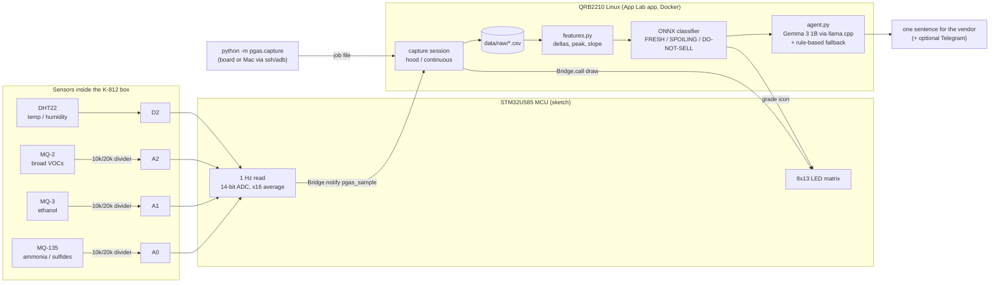

<p align="center">
  
</p>

<h1 align="center">PGAS</h1>
<p align="center"><b>AI Nose — The Modern Silver Spoon</b></p>
<p align="center">
  <b>PGAS (Patrick Get A Nose)</b> — 派大星有鼻子了<br>
  <b>Portable Gas Analysis System</b>（可攜式氣體分析系統）
</p>

People used to test food with a silver spoon, because silver turns black when it
meets sulfides. Spoiling food gives off ammonia, sulfides and ethanol. PGAS
"smells" those gases with three MQ sensors on an **Arduino UNO Q**. It grades the
food **FRESH / SPOILING / DO-NOT-SELL** on the board and gives the vendor one
concrete line of advice, such as *"sell the chicken at a discount before 14:00"*.

PGAS is built for night-market stalls and small food businesses. Selling spoiled
food is a food-safety risk, and throwing away food that is still good is waste.
Everything runs **offline on the board**: a scikit-learn classifier exported to
ONNX, and an open **Gemma 3 1B** model running under llama.cpp. No cloud
inference, no account, and no running cost.

> Status: hardware build and data collection in progress. Results will be added
> to this README and [`docs/results.md`](docs/results.md) only once they are
> measured. Until then every figure is a placeholder such as `[ACCURACY_TBD]`.

## How it works



* **MCU sketch** ([`app/sketch/sketch.ino`](app/sketch/sketch.ino)): reads A0–A2 and the DHT22 once a second, sends the readings to Linux over the Arduino Bridge, and draws the frames Linux sends back on the LED matrix.
* **Linux app** ([`app/python/main.py`](app/python/main.py) + [`pgas/`](pgas)): runs the capture sessions, extracts features, classifies, writes advice, and stores every raw reading as CSV.
* **CLI** ([`pgas/capture.py`](pgas/capture.py)): starts a capture from the board shell or from the Mac (`--host` / `--adb`). It needs only the standard library.
* **Simulation**: [`sim/`](sim). Open `sim/web/pgas-unoq-sim.html` in a browser to watch the sketch's UNO Q code path drive the board's LED matrix, read the sensors through the dividers and talk to Linux over the Bridge. The UNO Q MCU API is emulated, because no UNO Q simulator exists. An AVR/Wokwi variant and the CI end-to-end runs are also in `sim/`.
* **Mac**: trains the classifier ([`pgas/train.py`](pgas/train.py)) and makes the plots ([`pgas/plot.py`](pgas/plot.py)).

The classifier decides the grade. The LLM only turns grade + deadline into a
friendly sentence, and its output is checked. If the output contradicts the grade
or misses the deadline, or the LLM fails or takes more than 20 s, PGAS uses the
rule-based sentence instead (see [`pgas/agent.py`](pgas/agent.py)).

## Hardware

| Part | Pin on UNO Q | Notes |
|---|---|---|
| MQ-135 (ammonia, sulfides) | A0 | AO through 10 kΩ (top) / 20 kΩ (bottom) divider |
| MQ-3, Waveshare module (ethanol) | A1 | same divider |
| MQ-2 (broad VOCs) | A2 | same divider |
| DHT22 / AM2302 (bare) | D2 | 10 kΩ pull-up between VCC (3.3 V) and DATA |
| MQ heaters | 5 V | all grounds common |
| Power | USB-C | MacBook while developing; 5 V ⎓ 3 A power bank for demos |

Full details, the voltage budget and pre-power checks: [`docs/wiring.md`](docs/wiring.md). Parts list: [`docs/bom.md`](docs/bom.md).

## Setup on macOS (Apple Silicon)

All commands run **on the Mac** unless marked *board*.

```bash
# 1. Tools
brew install uv android-platform-tools     # uv = Python envs, adb = USB shell to the board

# 2. Code + tests (Mac)
git clone https://github.com/PGASlab/app.git pgas && cd pgas
uv venv .venv && uv pip install -e ".[dev]"
.venv/bin/python -m pytest

# 3. Board first setup: run Arduino App Lab once to name the board, set its
#    password and join Wi-Fi (this also enables ssh). Then check it:
scripts/board-info.sh <board-name>.local   # or: scripts/board-info.sh --adb

# 4. Deploy and start PGAS; --boot starts it automatically at power-on
scripts/deploy.sh <board-name>.local --boot
```

The **first start needs internet once**. App Lab compiles the sketch, installs
`numpy` + `onnxruntime` into the app's environment, and pulls the llama.cpp runner
and the Gemma 3 1B GGUF (722 MB). After that PGAS needs no network.

## Using it

```bash
# on the board (ssh <board-name>.local), or add --host <board-name>.local to run from the Mac
cd ~/ArduinoApps/pgas/python
python3 -m pgas.selftest                                   # PASS/FAIL hardware report
python3 -m pgas.capture --mode hood --label fresh_chicken   # one hood measurement
python3 -m pgas.capture --mode continuous --label chicken_room_temp --hours 48
python3 -m pgas.capture --stop                              # end a continuous recording
```

### Mode 1 – hood (demo and quick checks)

The LED matrix walks you through it, so you never need to look at a screen:

| Matrix | What to do | Time |
|---|---|---|
| `A` + countdown | hold the box in open air, away from food (baseline) | 30 s |
| `M` + countdown | move the box over the food, opening down, 3–5 cm above it | 5 s |
| `H` + countdown | hold still over the food, without touching it | 60 s |
| `V` + countdown | lift it away and let it air out, until readings return to baseline | up to 180 s |
| ✓ / ! / ✗ | grade: FRESH / SPOILING / DO-NOT-SELL, advice printed | — |

### Mode 2 – continuous (spoilage curves, hands-off)

Put a portion of food in or under the box, leave it, and start the capture. The
board writes one row per minute (the median of 60 one-second readings) for
24–48 h. The first 10 minutes are the "fresh" baseline. If the app restarts, it
resumes appending to the same file.

### Data, training, plots (Mac)

```bash
scripts/pull-data.sh <board-name>.local          # board data/raw -> repo data/raw
.venv/bin/python -m pgas.train                    # LOSO model selection -> models/*.onnx
.venv/bin/python -m pgas.plot                     # docs/figures/*.png
scripts/deploy.sh <board-name>.local              # ship the new model to the board
```

Every capture is `data/raw/<YYYYmmddTHHMMSS>_<mode>_<label>.csv`, plus a JSON
sidecar holding the settings and the on-board result. Labelling rules are in
[`docs/labeling.md`](docs/labeling.md).

## Results

| | |
|---|---|
| Leave-one-session-out accuracy | [ACCURACY_TBD] |
| On-board time from end of capture to advice | [LATENCY_TBD] |
| Data collected | [DATASET_TBD] |

## Why open source

A street vendor can't depend on a subscription, a cloud API or a phone signal.
Each part PGAS uses is open: the Arduino App Lab bricks, llama.cpp, Gemma, ONNX
Runtime, scikit-learn, and this code (MIT). That means anyone can rebuild it,
retrain it on their own food, or swap the model for a better one.

## Contributors

- [@k66inthesky](https://github.com/k66inthesky)
- [Claude](https://claude.ai/code), AI pair programmer

## License

[MIT](LICENSE)
