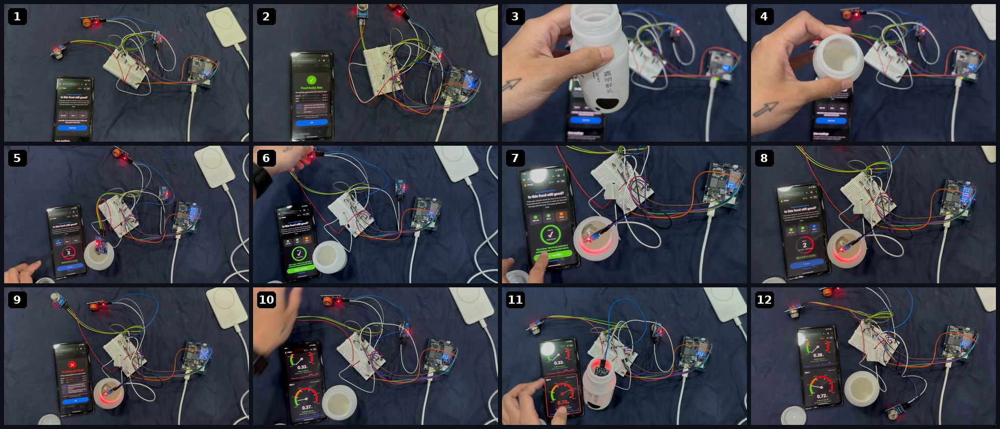
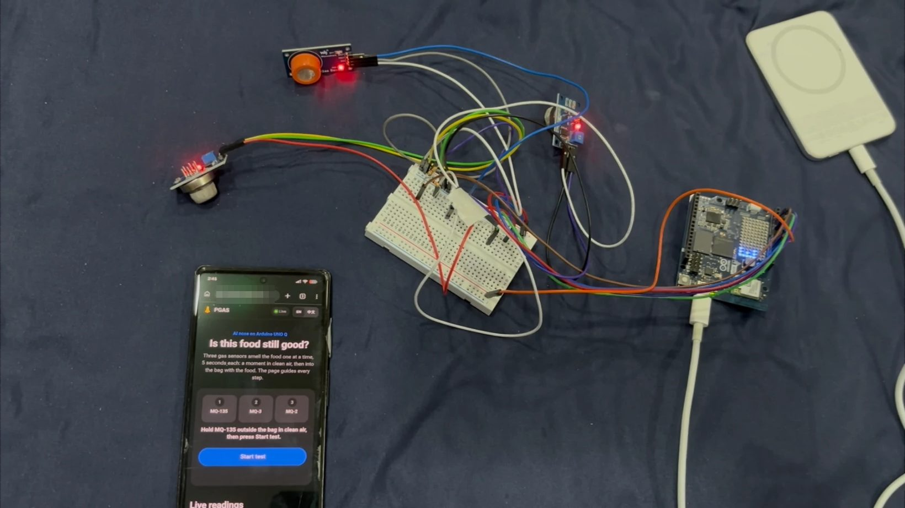
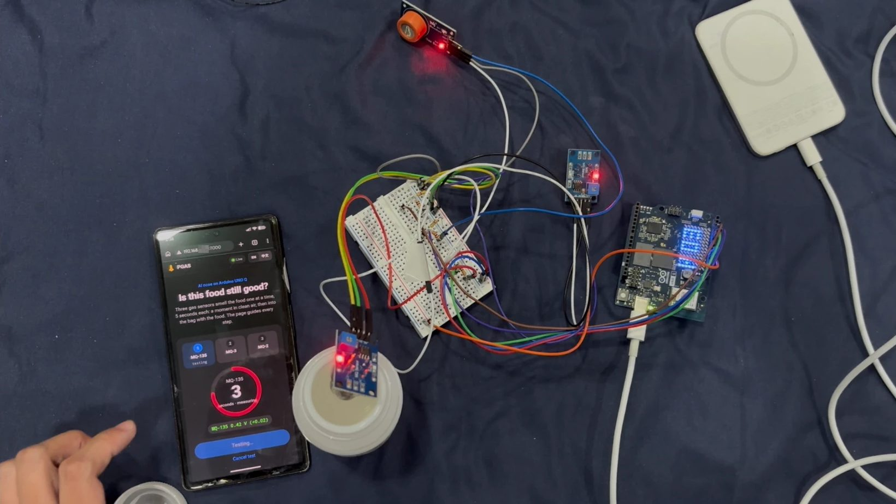
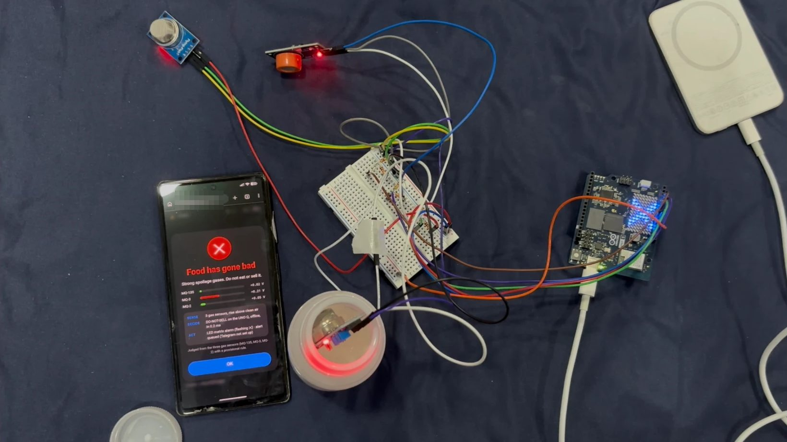
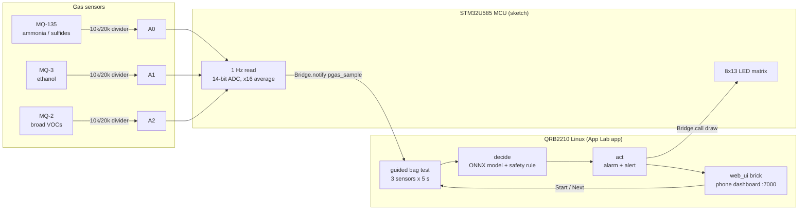

<p align="center">
  
</p>

<h1 align="center">PGAS</h1>

<p align="center"><b>An AI nose on the Arduino UNO Q that tells you when food has gone bad.</b></p>
<p align="center">
  <b>PGAS (Patrick Get A Nose)</b> — 派大星有鼻子了<br>
  <b>Portable Gas Analysis System</b>（可攜式氣體分析系統）
</p>

<p align="center">
  <a href="https://github.com/PGASlab/app/actions/workflows/tests.yml"></a>
  <a href="LICENSE"></a>
  
  
  
</p>

<p align="center">
  <a href="https://youtu.be/n88pRiuib3U">Demo video</a> ·
  <a href="docs/article.md">Article</a> ·
  <a href="https://claude.ai/artifact/BoE3spE76moKDwF9TGCZLH">Live simulation</a> ·
  <a href="#quick-start">Quick start</a> ·
  <a href="#how-it-works">How it works</a> ·
  <a href="#results">Results</a>
</p>

<p align="center">
  
</p>

<table>
  <tr>
    <td align="center" width="33%"><br><sub><b>1.</b> UNO Q, breadboard, 3 MQ sensors, power bank</sub></td>
    <td align="center" width="33%"><br><sub><b>2.</b> The phone guides each 5-second sensor test</sub></td>
    <td align="center" width="33%"><br><sub><b>3.</b> Spoiled milk → <b>DO-NOT-SELL</b>, LED matrix flashes ✕</sub></td>
  </tr>
</table>

People used to test food with a silver spoon, because silver turns black when it
meets sulfides. Spoiling food gives off ammonia, sulfides and ethanol. PGAS
smells those gases with three MQ sensors on an **Arduino UNO Q**, decides on
the board whether the food is **FRESH / SPOILING / DO-NOT-SELL**, and acts: the
LED matrix flashes, an alert goes out, and the phone shows the verdict.

## Features

- **Senses → decides → acts on the board.** A physical agent: gas sensors in,
  LED-matrix alarm and alert out, with no cloud in the loop.
- **One button.** Open the page on your phone, press **Start test**, follow the
  prompts. Three sensors, 5 seconds each.
- **Live gauges.** Speedometer dials for every sensor that turn red and blink
  above the limit, for anyone who wants the numbers.
- **Portable.** Runs on a USB-C power bank; the phone only needs the same Wi-Fi
  or hotspot as the board.
- **Offline and open.** App Lab bricks, ONNX Runtime, scikit-learn and this code
  (MIT). No account, no subscription, no running cost.
- **English / 繁體中文** dashboard.

## Results

Real readings from our board during the test in the photos above
([full photo set](docs/images)). This is a demo, not a formal accuracy study.

| Test | MQ-135 | MQ-3 | MQ-2 | Verdict | Decide time |
|---|---|---|---|---|---|
| Clean air, no food (photo 2) | +0.03 V | +0.02 V | +0.00 V | FRESH | 0.6 ms |
| Spoiled milk, guided test (photo 9) | +0.02 V | **+0.21 V** | +0.05 V | **DO-NOT-SELL** | 0.2 ms |

Rise = reading in the food container minus the sensor's own clean-air reading.

MQ-3 (ethanol) held by hand, module output (photos 10–12):

| Clean air | Over the spoiled milk | 30 s after taking it away |
|---|---|---|
| 0.37 V | **0.70 V** | 0.38 V |

The verdict comes from an **on-board ONNX model** ([`pgas/bag_model.py`](pgas/bag_model.py)):
a scikit-learn logistic regression on the three rises, run by ONNX Runtime on
the UNO Q, trained on the real tests above (clean air → 7% spoiled, milk → 93%).
With only three real samples, a safety rule ([`pgas/rules.py`](pgas/rules.py):
≥ 0.10 V SPOILING, ≥ 0.20 V DO-NOT-SELL) double-checks it and the more severe
verdict wins. Retrain with `.venv/bin/python -m pgas.bag_model`.

## How it works

> **Try it without hardware:** [live UNO Q simulation](https://claude.ai/artifact/BoE3spE76moKDwF9TGCZLH).



| Step | What happens | Where |
|---|---|---|
| **Sense** | MQ-135, MQ-3 and MQ-2 read at 1 Hz, 14-bit ADC, averaged 16× | MCU sketch ([`app/sketch/sketch.ino`](app/sketch/sketch.ino)) |
| **Decide** | Rise of each sensor in the food container over its own clean-air reading | Linux ([`pgas/session.py`](pgas/session.py), [`pgas/rules.py`](pgas/rules.py)) |
| **Act** | LED matrix ✓ or flashing ✕, alert ([`pgas/notify.py`](pgas/notify.py)), verdict on the phone | MCU + Linux ([`pgas/board.py`](pgas/board.py)) |

The MCU and Linux halves of the UNO Q talk over the Arduino **Bridge**. The
dashboard is served by the official App Lab `arduino:web_ui` brick
([`app/assets`](app/assets), [`pgas/web.py`](pgas/web.py)) and needs no internet.

## Hardware

| Part | Pin on UNO Q | Notes |
|---|---|---|
| MQ-135 (ammonia, sulfides) | A0 | AO through 10 kΩ (top) / 20 kΩ (bottom) divider |
| MQ-3, Waveshare module (ethanol) | A1 | same divider |
| MQ-2 (broad VOCs) | A2 | same divider |
| MQ heaters | 5 V | all grounds common |
| Power | USB-C | laptop while developing; 5 V ⎓ 3 A power bank for portable use |
| DHT22 (optional) | D2 | temperature / humidity only; the verdict does not use it |

The UNO Q's analog pins are not 5 V tolerant, so every MQ output goes through a
divider (5 V → 3.33 V max). Details and pre-power checks:
[`docs/wiring.md`](docs/wiring.md). Parts list: [`docs/bom.md`](docs/bom.md).

## Quick start

All commands run **on the Mac** unless marked *board*.

```bash
# 1. Tools
brew install uv android-platform-tools     # uv = Python envs, adb = USB shell to the board

# 2. Code + tests
git clone https://github.com/PGASlab/app.git pgas && cd pgas
uv venv .venv && uv pip install -e ".[dev]"
.venv/bin/python -m pytest

# 3. First board setup: run Arduino App Lab once to name the board, set its
#    password and join Wi-Fi. Then check it:
scripts/board-info.sh --adb                # or: scripts/board-info.sh <board-name>.local

# 4. Deploy; --boot starts PGAS at power-on and installs a keep-alive
scripts/deploy.sh --adb --boot
```

Then open `http://<board-name>.local:7000` (or `http://<board-ip>:7000`) on a
phone on the same Wi-Fi and press **Start test**. The first start needs internet
once so App Lab can compile the sketch and install Python packages; after that
PGAS runs offline.

### The guided test

1. Put the food in a small sealed bag or container that fits one sensor.
2. Press **Start test**. For each sensor (MQ-135 → MQ-3 → MQ-2), 5 seconds:
   1 s in clean air, 1 s to put it in, 3 s measuring.
3. Between sensors, swap and press **Ready – test MQ-x**.
4. The pop-up says **Food looks fine** or **Food has gone bad**, with each
   sensor's rise and the sense / decide / act steps. Scroll down for the live
   gauges and charts.

### Command line and data collection

```bash
# on the board (adb shell / ssh), in ~/ArduinoApps/pgas/python
python3 -m pgas.selftest                                    # PASS/FAIL hardware report
python3 -m pgas.capture --mode hood --label fresh_chicken    # one labelled capture
python3 -m pgas.capture --mode continuous --label chicken_room_temp --hours 48
python3 -m pgas.capture --stop

# on the Mac
scripts/pull-data.sh --adb                 # board data/raw -> repo data/raw
.venv/bin/python -m pgas.train             # LOSO model selection -> models/*.onnx
.venv/bin/python -m pgas.plot              # docs/figures/*.png
```

Every capture is `data/raw/<YYYYmmddTHHMMSS>_<mode>_<label>.csv` plus a JSON
sidecar. Labelling rules: [`docs/labeling.md`](docs/labeling.md).

## Roadmap

- [x] Three MQ sensors on the UNO Q with safe dividers
- [x] Guided one-button test from the phone, Apple-style dashboard
- [x] On-board sense → decide → act loop with LED-matrix alarm
- [x] Power-bank operation and keep-alive after a reset
- [ ] Collect labelled captures of more foods
- [x] On-board scikit-learn → ONNX model for the guided test ([`pgas/bag_model.py`](pgas/bag_model.py))
- [ ] Retrain it on many more foods, then let it decide without the safety rule
- [ ] Optimize the model for the board with Qualcomm AI Hub ([`pgas/aihub.py`](pgas/aihub.py))
- [ ] Telegram alerts ([`pgas/notify.py`](pgas/notify.py), token stays on the board)

## Project layout

```
app/            App Lab app: sketch (MCU), python/main.py (Linux), assets (dashboard)
pgas/           Python package: sessions, rules, board runtime, web feed, training
scripts/        deploy, board-info, pull-data (ssh or --adb)
sim/            browser and CI simulations of the UNO Q
docs/           article, wiring, BOM, labelling, photos
tests/          pytest suite (runs in CI)
```

## Disclaimer

PGAS is a reference tool, not a food-safety certification. If in doubt, do not
eat it, and ask a professional.

## Contributors

- [@k66inthesky](https://github.com/k66inthesky)
- [Alice](https://github.com/Alitsen777)
- [29](https://github.com/0x29dev)
- [Crystal](https://github.com/Crystal32378)
- [Cynthia](https://github.com/cynthiachi-268)
- [Claude](https://claude.ai/code), AI pair programmer

## License

[MIT](LICENSE)
